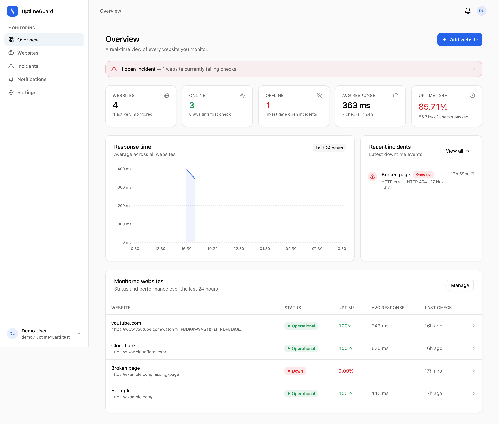
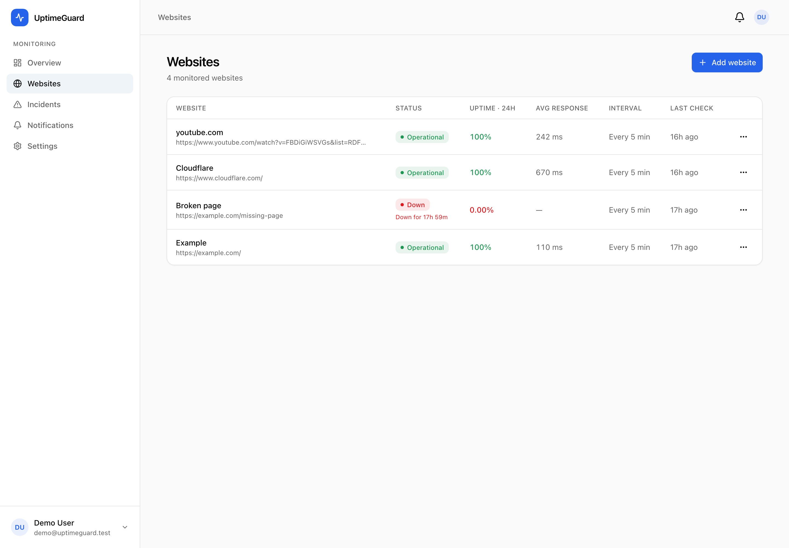
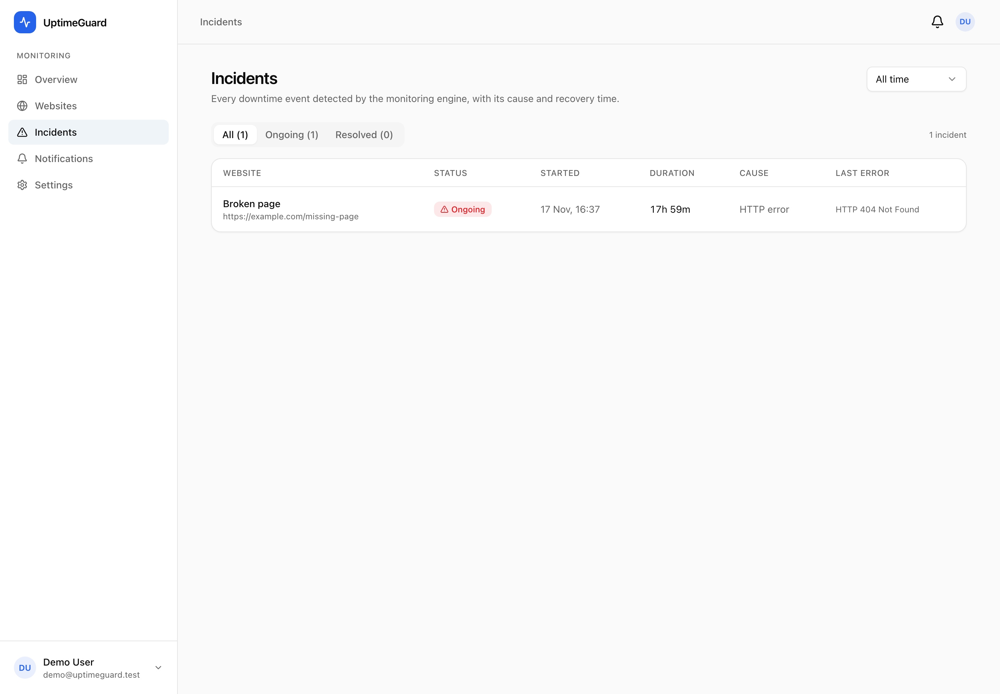
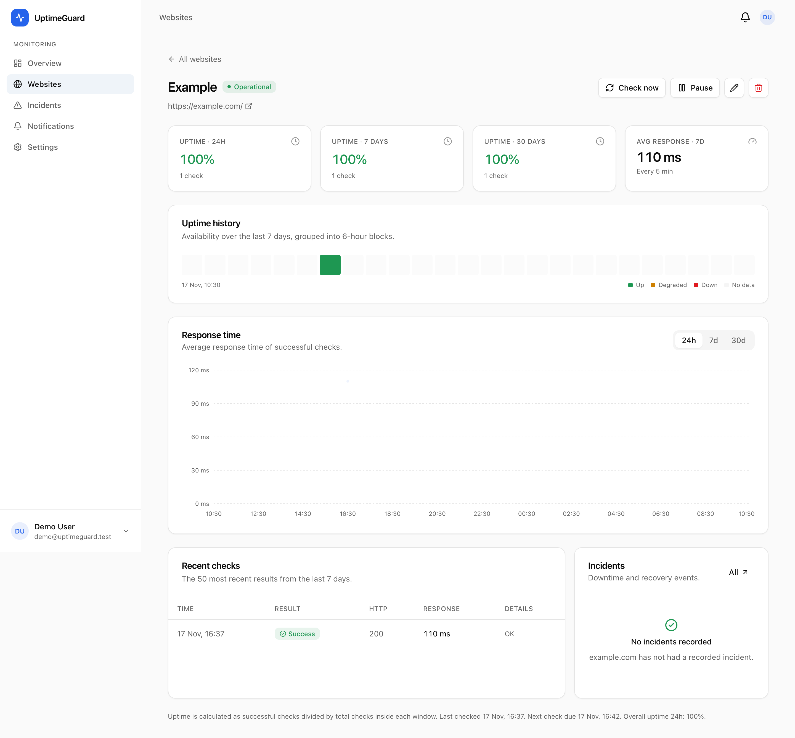
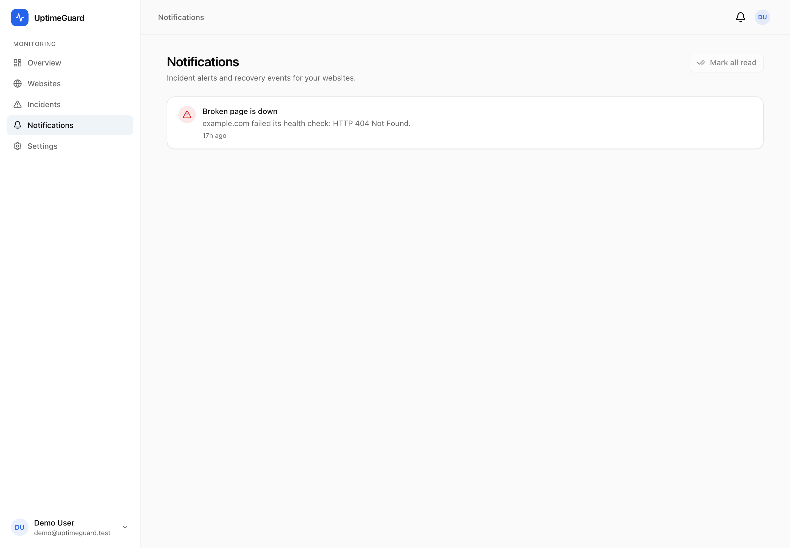
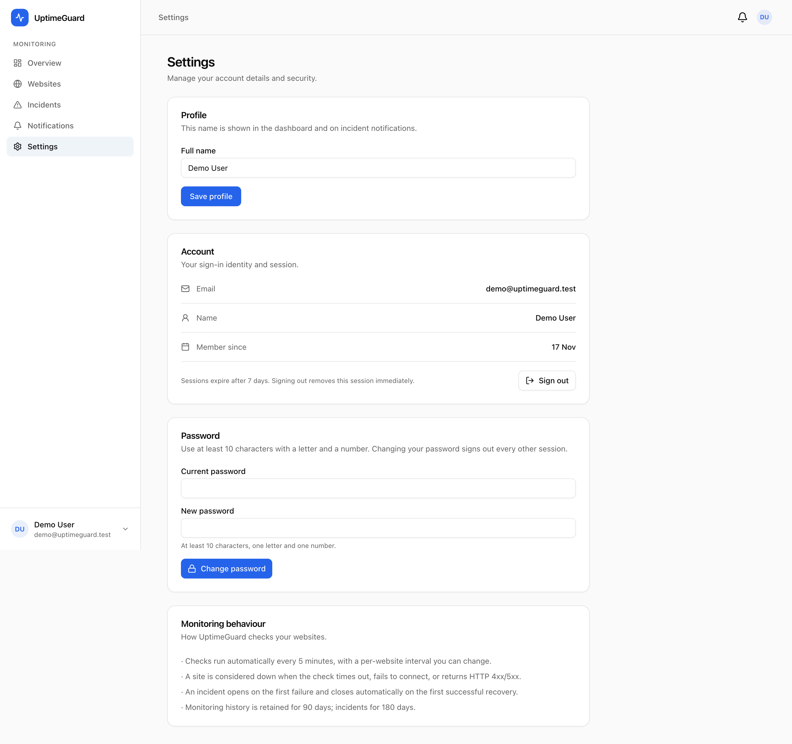

# UptimeGuard

A production-ready website health monitoring SaaS built entirely on Cloudflare's free tier. UptimeGuard checks your sites every five minutes, records response times, opens and resolves incidents automatically, and shows uptime trends in a clean, responsive dashboard.



**Live deployment:** <https://uptime-guard.tholetiharsha2078.workers.dev>

## Features

- **Website management** — add, rename, pause/resume, and delete monitors with validated public HTTP/HTTPS URLs.
- **Automatic checks** — Cloudflare Cron Triggers run the scheduler every 5 minutes, with a per-website interval (5–60 minutes).
- **Real health checks** — 10-second timeout, manual redirect following (max 3), HTTP 2xx/3xx treated as up, 4xx/5xx and network failures as down.
- **Uptime and response analytics** — 24-hour, 7-day, and 30-day uptime, average response time, hourly response series, and a 7-day availability timeline.
- **Incidents** — the first failure opens an incident, the first success resolves it, and every event records cause, duration, status code, and error.
- **Notifications** — in-app incident and recovery alerts with per-item and mark-all-read actions.
- **Dashboard** — live totals, 24-hour uptime, average response time, response chart, recent incidents, and a monitored-website table.
- **Security-first** — authenticated sessions, rate limiting, parameterized queries, strict input validation, and SSRF/DNS-rebinding protection.
- **Polished UI** — React + Tailwind + shadcn-style components, light SaaS theme, green/red/blue status language, responsive tables, loading/empty/error states.
- **No mock data** — every number on screen comes from D1 through the Worker API.

## Tech stack

| Layer      | Technology                                             |
| ---------- | ------------------------------------------------------ |
| Frontend   | React 19, Vite 8, TypeScript (strict), Tailwind CSS 4  |
| Components | shadcn/ui-style primitives, Lucide icons, Recharts      |
| Data layer | TanStack Query, React Router, React Hook Form + Zod     |
| API        | Hono on Cloudflare Workers                              |
| Database   | Cloudflare D1 (SQLite) with Drizzle ORM                 |
| Scheduling | Cloudflare Cron Triggers (`*/5 * * * *`)                |
| Tests      | Vitest                                                  |
| Deploy     | Wrangler, Cloudflare Workers + static assets            |

## Architecture

```text
Browser (React SPA)
  │  /api/*  (same-origin, session cookie)
  ▼
Cloudflare Worker (Hono)
  ├── auth middleware ── sessions (SHA-256 token hash in D1)
  ├── routes: auth / websites / dashboard / incidents / notifications
  ├── services: monitor, check-runner, incidents, analytics, scheduler
  ├── SSRF guard: Cloudflare DoH + private/reserved address blocking
  └── D1 (SQLite)
        users, sessions, websites, monitoring_logs,
        incidents, notifications, monitor_runs, rate_limits

Cron Trigger (*/5 * * * *) ── scheduler
  ├── D1 lock row (monitor_runs) prevents overlapping runs
  ├── claims due sites by advancing next_check_at atomically
  └── checks in batches of 20 with concurrency 5
```

Static assets are served by Workers Static Assets with SPA fallback. Only `/api/*` runs the Worker first.

## Project structure

```text
.
├── worker/
│   ├── index.ts              # Hono app, middleware, cron handler
│   ├── db/schema.ts          # Drizzle schema (8 tables)
│   ├── lib/                  # auth, SSRF, rate limiting, validation, errors
│   ├── routes/               # REST endpoints
│   └── services/             # monitor, scheduler, incidents, analytics
├── shared/                   # types, Zod schemas, URL validation (frontend + Worker)
├── src/
│   ├── components/           # layout, charts, UI primitives, dialogs
│   ├── pages/                # dashboard, websites, detail, incidents, notifications, settings
│   └── lib/                  # API client, formatting, labels
├── migrations/               # D1 SQL migrations generated by Drizzle
├── tests/                    # Vitest unit tests
├── docs/screenshots/         # README screenshots
├── scripts/                  # screenshot capture utility
└── wrangler.jsonc            # Worker, D1, assets, cron configuration
```

## Screenshots

| Websites | Incidents |
| --- | --- |
|  |  |

| Website detail | Notifications |
| --- | --- |
|  |  |

| Settings |
| --- |
|  |

## Quick start (local)

### Prerequisites

- Node.js 20+
- A Cloudflare account
- Wrangler authenticated: `npx wrangler login`

### 1. Install dependencies

```bash
npm ci
```

### 2. Create the D1 database

```bash
npx wrangler d1 create uptime-guard-db
```

Copy the returned `database_id` into `wrangler.jsonc` under `d1_databases[0].database_id`.

### 3. Configure local environment

```bash
cp .env.example .dev.vars
```

`.dev.vars` is gitignored. The defaults are sufficient for local development.

### 4. Apply migrations locally

```bash
npm run db:init
```

### 5. Run both dev servers

```bash
npm run dev:api   # Worker API on http://127.0.0.1:8787
npm run dev       # Vite frontend on http://127.0.0.1:5173
```

Open <http://127.0.0.1:5173>, register an account, and add a public website such as `https://example.com`.

> Vite proxies `/api` to the Worker at `http://127.0.0.1:8787` (see `vite.config.ts`), so the browser sees same-origin requests and the session cookie works normally.

### 6. Trigger a check without waiting for cron

Use the **Check now** button in the UI. Locally you can also invoke the scheduled handler:

```bash
curl http://127.0.0.1:8787/cdn-cgi/local/scheduled
```

## Environment variables

| Variable            | Required | Description                                                        |
| ------------------- | -------- | ------------------------------------------------------------------ |
| `ENVIRONMENT`       | Yes      | `development` or `production`.                                     |
| `DEMO_MODE`         | No       | `1` disables API rate limits for local testing. Never in production. |
| `RESEND_API_KEY`    | No       | Reserved for future email alerts. Not used yet.                    |
| `ALERT_FROM_EMAIL`  | No       | Reserved for future email alerts. Not used yet.                    |

`APP_NAME` and `ENVIRONMENT` are also declared as Worker vars in `wrangler.jsonc`.

## Scripts

| Command                  | Description                                        |
| ------------------------ | -------------------------------------------------- |
| `npm run dev`            | Start the Vite frontend.                           |
| `npm run dev:api`        | Start the Worker API locally on port 8787.         |
| `npm run build`          | Typecheck the app and build static assets.         |
| `npm run typecheck`      | Typecheck frontend and Worker code.                |
| `npm test`               | Run the Vitest suite.                              |
| `npm run db:generate`    | Generate a new Drizzle migration.                  |
| `npm run db:init`        | Apply migrations to local D1.                      |
| `npm run db:reset`       | Delete local D1 state and re-apply migrations.     |
| `npm run db:migrate:remote` | Apply migrations to the remote D1 database.     |
| `npm run deploy`         | Build and deploy with Wrangler.                    |

## API

All endpoints are under `/api`, return JSON, and require a valid session unless noted.

| Method | Path                        | Purpose                                  |
| ------ | --------------------------- | ---------------------------------------- |
| GET    | `/api/health`               | Public health check (verifies D1).       |
| POST   | `/api/auth/register`        | Create an account and session.           |
| POST   | `/api/auth/login`           | Sign in.                                 |
| POST   | `/api/auth/logout`          | Revoke the current session.              |
| GET    | `/api/auth/me`              | Current user.                            |
| PATCH  | `/api/auth/me`              | Update display name.                     |
| POST   | `/api/auth/change-password` | Rotate password, revoke other sessions.  |
| GET    | `/api/websites`             | List monitors with 24-hour stats.        |
| POST   | `/api/websites`             | Create a monitor.                        |
| GET    | `/api/websites/:id`         | Monitor detail with 24h/7d/30d stats.    |
| PATCH  | `/api/websites/:id`         | Rename, change interval, pause/resume.   |
| DELETE | `/api/websites/:id`         | Delete monitor and dependent records.    |
| POST   | `/api/websites/:id/check`   | Run an immediate check.                  |
| GET    | `/api/websites/:id/logs`    | Recent checks (limit/range).             |
| GET    | `/api/websites/:id/series`  | Response-time series for charts.         |
| GET    | `/api/dashboard`            | Aggregate dashboard payload.             |
| GET    | `/api/incidents`            | Incidents filtered by status/range.      |
| GET    | `/api/notifications`        | Latest notifications and unread count.   |
| POST   | `/api/notifications/read-all` | Mark all notifications read.           |
| POST   | `/api/notifications/:id/read` | Mark one notification read.            |

## Monitoring engine

1. Cron fires every 5 minutes and the scheduler acquires a D1-backed lock (`monitor_runs`) with a 4-minute lease.
2. Up to 20 due websites are selected (`is_paused = 0 AND next_check_at <= now`).
3. Each website is claimed with a conditional `UPDATE` that advances `next_check_at`, so concurrent runs cannot double-check it.
4. Checks run with concurrency 5. Each request has a hard 10-second `AbortSignal` budget.
5. Redirects are followed manually (max 3). Every hop is re-resolved and re-validated by the SSRF guard.
6. A response is **up** for HTTP 2xx/3xx, **down** for 4xx/5xx. Timeouts, DNS failures, TLS errors, and blocked targets are recorded with their cause.
7. The check runner writes a `monitoring_logs` row, updates website status, and opens or resolves an incident.
8. Incidents and recoveries create in-app notifications. A partial unique index guarantees at most one open incident per website.
9. Housekeeping (probabilistically, to spread load) deletes logs older than 90 days, resolved incidents older than 180 days, expired sessions, and stale rate-limit rows.

## Security

### SSRF and DNS rebinding

- Only `http://` and `https://` are accepted; credentials in URLs are rejected.
- Ports are restricted to **80, 443, 8080, 8443**.
- Every hostname is resolved through **Cloudflare DNS-over-HTTPS**; all A/AAAA answers are checked.
- Private, loopback, link-local, CGNAT, multicast, reserved, documentation, and IPv6 ULA/link-local ranges are blocked, including obfuscated IPv4 notations.
- Internal suffixes and metadata hosts (`.local`, `.internal`, `.localhost`, `metadata.google.internal`, `kubernetes.default`, etc.) are rejected.
- Redirects are followed manually and validated hop by hop, preventing redirect-based bypasses.
- The Worker never forwards user-controlled credentials or arbitrary headers.

### Authentication and sessions

- Passwords hashed with **PBKDF2-SHA256, 100,000 iterations**, per-user random salt. The iteration count is chosen to stay within Workers free-tier CPU limits; raise it if your plan allows.
- Sessions use an opaque 256-bit token in an `HttpOnly`, `SameSite=Lax`, `Path=/` cookie, `Secure` in production, with a 7-day expiry.
- Only the SHA-256 hash of the session token is stored in D1.
- Password changes revoke every other session.
- Cookies are checked for expiry on every authenticated request.

### API hardening

- Zod validation on every request body and query parameter.
- Parameterized D1 queries everywhere (no string interpolation of user input).
- State-changing requests verify the `Origin` header (same-origin, plus localhost in development).
- Security headers: `X-Content-Type-Options`, `X-Frame-Options: DENY`, `Referrer-Policy`, `Permissions-Policy`, `Cross-Origin-Opener-Policy`.
- API responses use `Cache-Control: no-store`.
- Request bodies capped at 64 KB.
- Rate limits (per IP + route, stored in D1):

| Route                | Limit          |
| -------------------- | -------------- |
| Register             | 5 / hour       |
| Login                | 10 / 5 minutes |
| Profile update       | 20 / hour      |
| Change password      | 5 / hour       |
| Create website       | 30 / hour      |
| Update website       | 120 / hour     |
| Delete website       | 60 / hour      |
| Manual check         | 20 / 5 minutes |

## Testing

```bash
npm test
```

The suite covers URL validation and private-range detection, HTTP check outcomes (success, 4xx/5xx, timeout, redirects, blocked targets), password hashing, request schemas, and uptime aggregation. All tests run without network access or a live database.

## Deployment (Cloudflare)

### 1. Apply migrations remotely

```bash
npx wrangler d1 migrations apply uptime-guard-db --remote
```

### 2. Build and deploy

```bash
npm run deploy
```

This typechecks, builds the SPA into `dist/`, and deploys the Worker with static assets, D1 binding, and the cron trigger from `wrangler.jsonc`.

### 3. Verify

```bash
curl https://<your-worker>.workers.dev/api/health
```

Expected response:

```json
{ "status": "ok", "service": "UptimeGuard", "environment": "production" }
```

Register an account, add a website, and wait for the next 5-minute cron tick (or use **Check now**).

### Cron verification

In the Cloudflare dashboard, open **Workers & Pages → uptime-guard → Settings → Triggers**. The cron `*/5 * * * *` should be listed. Scheduled runs are visible in **Logs** (observability is enabled in `wrangler.jsonc`).

### Custom domain

Add a route or custom domain in the Cloudflare dashboard if you want to serve the app from your own hostname. Cookies become `Secure` automatically when `ENVIRONMENT=production`.

## Screenshot capture

Screenshots are generated with headless Chrome through the DevTools protocol, so no extra npm packages are required:

```bash
UG_SESSION="<ug_session cookie value>" node scripts/capture-screenshots.mjs
```

The script signs in with the supplied session cookie, captures each page at 1440px, and writes PNGs to `docs/screenshots/`. Adjust the `pages` array to capture a different website or route.

## Current limitations

- Notifications are **in-app only**. Email delivery is intentionally deferred; `RESEND_API_KEY` and `ALERT_FROM_EMAIL` are reserved for that phase.
- The response chart shows data only for periods in which checks ran. A new account with a single check displays a single point until more history accumulates.
- Uptime uses successful checks divided by total checks in the selected window; it does not weight downtime by duration.
- Monitoring runs from Cloudflare's network, so results reflect that vantage point (a site may be up globally but unreachable from a specific colo).
- Free-tier limits apply: Worker CPU time, D1 rows read/written, and cron execution time. The scheduler is designed to stay within them.

## License

This project is provided as-is for the owner's use. Add a license before distributing it publicly.
